<p align="center">
  
</p>

### › whoami

Most work inside a company isn't hard, it's repetitive: copying data between screens, chasing approvals, rebuilding the same report every Monday. I want to be the person who makes that work disappear.

I design how a system should behave: numbered requirements, expected interactions, the edge cases nobody wrote down. Then I direct AI through the build and test every version until it does exactly that. The road ahead is **AI automation and integration engineering**: Python, APIs and databases, orchestrated with n8n and LLM agents, with a human approval wherever a mistake would cost money.

**How I build, plainly:** AI writes most of my code. My job is knowing what it should do, proving when it doesn't, and making it explain the decisions that matter. I'm learning the fundamentals so I can judge every line it hands me.

<br>

<p align="center">
  
</p>

### › principles

```text
BEHAVIOR BEFORE CODE    Define what it must do, and what it must never do.
EDGE CASES ARE THE JOB  Test until it breaks. Write down exactly why.
BORING IS A BUG         If a person copies data between two screens, automate it.
HUMANS HOLD THE KEYS    AI acts, people approve. Every automation gets an off switch.
SPEAK IN EUROS          Hours saved and errors avoided, not "AI-powered".
```

<br>

<p align="center">
  
</p>

### › contact

**Open to** automation, integration, applied AI, forward-deployed and solutions roles, and to freelance work on any process that eats hours every week.

<!-- Add your direct links here, e.g.:
[LinkedIn](https://www.linkedin.com/in/your-handle) · [Email](mailto:you@example.com)
-->
**[→ Start a conversation](https://github.com/Auvendra/Auvendra/issues/new?title=Hello%20Auvendra&body=What%20process%20are%20you%20trying%20to%20fix%3F)** and tell me which process you'd like gone.

<br>

<p align="center">
  
</p>

<p align="center">
  <sub>This profile is its own case study: I set the brief and the bar, AI wrote <a href="tools/build.py">the generator</a> that builds each card.<br>
  Mikasa Ackerman from <i>Attack on Titan</i> © Hajime Isayama / Kodansha. Type set in JetBrains Mono (OFL).</sub>
</p>
