<p align="center">
  
</p>

### › whoami

I like making things easier. If something is repetitive, slow or just annoying to use, I'll usually end up trying to fix it.

I build with AI. I explain what I want in detail: what each part should do, where things should go and what should happen when something goes wrong. Then I use it, find the bugs and keep going back until it behaves how I wanted. AI writes most of the code; I handle the directions, testing and figuring out what's wrong.

I'm still learning Python, SQL and APIs. I want to get into automation and integration and build things that save people doing the same work over and over.

<br>

<p align="center">
  
</p>

### › how I think

```text
Explain exactly what it should do.
Try it. Find what breaks. Explain what's wrong.
Fix it and check again.
If it keeps needing manual work, make it easier.
```

<br>

<p align="center">
  
</p>

### › contact

**Open to** automation, integration and applied AI roles, or freelance work on something you're tired of doing manually.

**[→ Get in touch](https://github.com/Auvendra/Auvendra/issues/new?title=Hello%20Auvendra&body=What%20are%20you%20trying%20to%20make%20easier%3F)** and tell me what you're trying to make easier.

<br>

<p align="center">
  
</p>

<br>

<p align="center">
  
</p>

### › things I've worked on

<p align="center">
  
</p>
